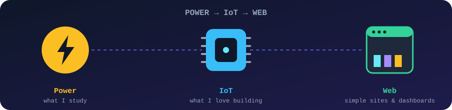
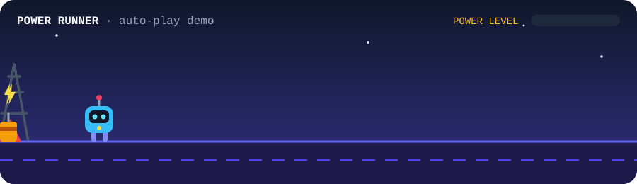

<div align="center">



</div>


## 🚀 About Me

Hello! I'm **Pinandhita**, an **Electrical Engineering student** with a concentration in **Power**. Alongside my major, I'm a **Technology and IoT Enthusiast** with a strong interest in exploring technological innovations and developing technology-based projects.

My studies give me a solid foundation in electricity and power systems, while my side passion is building **IoT projects** and **simple websites** that bring ideas to life, from sensors and devices to dashboards you can actually see.

I enjoy understanding how systems work, exploring Internet of Things (IoT) applications, and turning ideas into practical projects.

Beyond technology and engineering, I also explore **AI-assisted development tools** to create digital experiences and expand my knowledge in the digital world.

> 💡 *Technology is not just about writing code, but also about understanding problems, developing ideas, and creating meaningful solutions.*



## 🎯 My Interests

| | Area | What drives me |
|---|------|----------------|
| ⚡ | **Electrical Power** | My major, the foundation of everything I build |
| 🌐 | **Internet of Things (IoT)** | Connecting devices to the real world |
| 💻 | **Simple Website Development** | Showing data and ideas through clean web pages |
| ⚙️ | **Technology & Engineering** | Understanding how systems work |
| 🛠️ | **Project Development** | Turning ideas into working projects |
| 🔗 | **System Integration** | Making different parts work together |
| 🤖 | **Artificial Intelligence** | Exploring AI-assisted development |
| ✨ | **Digital Innovation** | Creating meaningful digital experiences |


## 🎮 Mini Game: Power Runner

Watch my little robot dodge short circuits and overloaded capacitors, all on its own!



<!--
  Want a version people can actually PLAY?
  1. Enable GitHub Pages on a repo that contains the /game folder.
  2. Uncomment the line below and replace YOUR_USERNAME / REPO_NAME.

👉 **[Play it yourself!](https://YOUR_USERNAME.github.io/REPO_NAME/game/)** Press Space or tap to jump.
-->


## 🔄 How I Work

```text
  💭 Idea ──► 🔍 Understand the problem ──► 🧩 Build ──► 🎉 Meaningful solution
     ▲                                                          │
     └─────────────  keep learning & improving  ◄───────────────┘
```

<details>
<summary>🎮 <b>Click me for a fun fact!</b></summary>
<br>

> Every big system started as a tiny "Hello, World!" 🌍
>
> `while (curious) { learn(); build(); repeat(); }` 🔁

</details>

<div align="center">

*Thanks for stopping by! Have a great day* ☕✨

</div>
